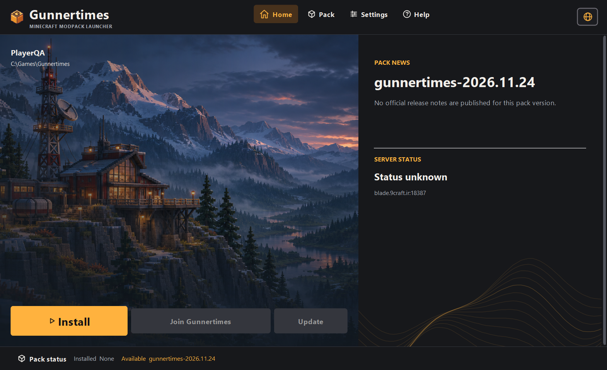
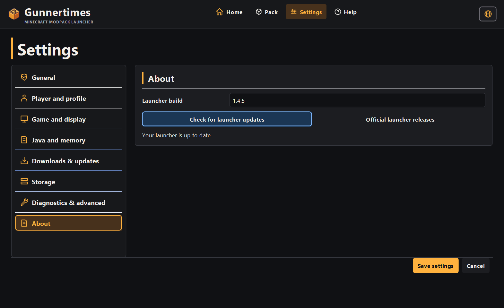
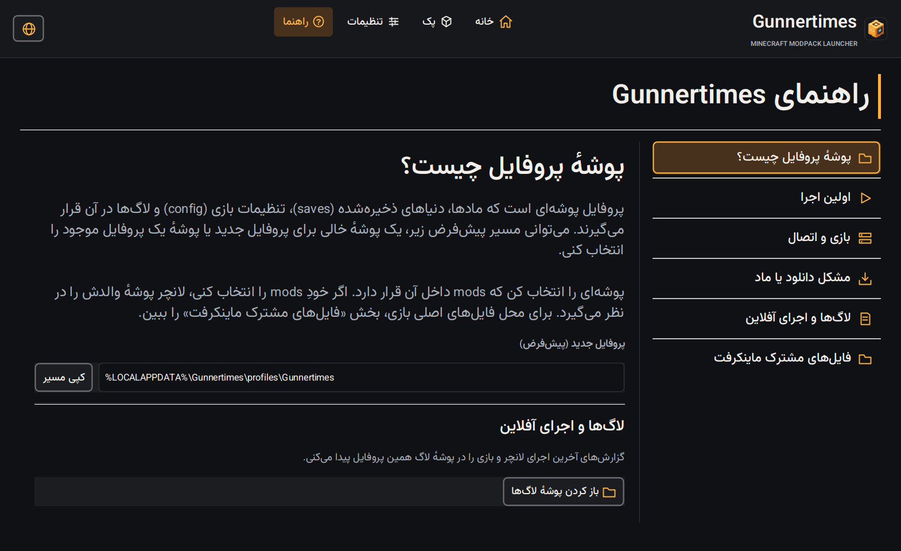

# Gunnertimes Launcher

Windows x64 launcher for the official Gunnertimes pack, Minecraft 26.3 and Fabric Loader 0.20.1.

[Download the latest stable build](https://github.com/ParsaUltimate/gunnertimes-releases/releases/latest)



## Install on Windows

| Download | How to run it |
| --- | --- |
| [Gunnertimes-Setup.exe](https://github.com/ParsaUltimate/gunnertimes-releases/releases/latest/download/Gunnertimes-Setup.exe) | Run Setup. Gunnertimes opens when installation is complete and is available from Start or the desktop. Java 25 is included. The installer uses your Windows user account and supports uninstall from Installed apps. |
| [Gunnertimes-Portable.jar](https://github.com/ParsaUltimate/gunnertimes-releases/releases/latest/download/Gunnertimes-Portable.jar) | Install Java 25 x64, put the JAR in a writable folder and run the command below. |

```powershell
java -jar Gunnertimes-Portable.jar
```

## First launch

1. Open **Settings → Player and profile**. Enter an offline username of 3–16 characters using English letters, digits or underscores.
2. Keep the default profile to create a fresh installation. To reuse an existing profile, choose the directory containing its `mods` folder. Select **Save settings**.
3. On **Home**, select **Install** and wait for the signed pack to finish installing. Then select **Play** to prepare Minecraft and start the game. Use an internet connection during setup and whenever required files need to be downloaded.

Use the globe in the top navigation to switch between English and فارسی. The launcher remembers your language.

## Where files are stored

| Path | What goes there |
| --- | --- |
| `%APPDATA%\.minecraft` | The **default shared location** for Minecraft and Fabric files. Gunnertimes uses the healthy files in `assets`, `libraries` and `versions` directly from this folder. |
| `%LOCALAPPDATA%\Gunnertimes\profiles\Gunnertimes` | The default Gunnertimes profile. The selected profile holds your `mods`, `config`, `saves` and `logs`. |

Gunnertimes resolves the shared location automatically from the current Windows user. It creates the required directories when preparing the game. It can reuse verified files from the older launcher cache to fill gaps, or download and verify missing and damaged files from the official Minecraft and Fabric sources. The game then reads the shared files in `.minecraft`. See the resolved path in **Settings → Downloads & updates**.

A profile can live anywhere writable. For an existing instance, use the folder that contains its mods, settings and worlds. If you select its `mods` folder, the launcher uses the parent directory.

## What the launcher does

| Area | Actions and information |
| --- | --- |
| **Home** | **Install** installs the official pack. **Play** starts Minecraft with the installed pack. **Join Gunnertimes** also attempts to connect to the official server. **Update** previews a newer pack before installing it. Home shows installed and available pack versions and server status when available. |
| **Pack** | Search official mods by name, ID, version or filename. See the installed release and file health. **Verify files** checks the files without changing them. **Repair** previews changes and restores the installed official pack while preserving unrelated files. |
| **Settings** | Set the player name, profile, display options, Java and RAM. Open the storage and diagnostics pages to find folders, measure disk usage or copy a diagnostic summary. Check for launcher updates in **Downloads & updates**. |
| **Help** | Find first-launch steps, copy profile paths, understand Play and Join, troubleshoot downloads and mods, and open the logs for the current profile. |

Launcher updates and pack updates are independent. Gunnertimes checks for launcher updates on startup. It verifies the signed release information and the downloaded EXE or JAR before applying a launcher update.

<details>
<summary>More launcher screenshots</summary>

**Pack in Persian**


**Settings in English**



**Help in Persian**



</details>

## Troubleshooting

- **Setup failed.** Note the error code shown in Setup. The installation log is under `%LOCALAPPDATA%\Gunnertimes\setup-logs`.
- **Download failed.** Reconnect and select **Try again**. Already verified files can be reused.
- **Official mod damaged.** Close Minecraft, go to **Pack → Verify files**, then preview and confirm **Repair**. If the launcher names a conflicting manual mod, back it up and move it outside the profile’s `mods` folder before retrying.
- **Minecraft did not start or closed.** Select **Open game log** from the progress panel when available. Use **Help → Logs and offline use → Open logs** for launcher and game logs in the active profile.
- **Playing offline.** Once the official pack and required game files are present, **Play** works offline for single-player. A multiplayer server must accept offline accounts.

## Windows Setup

On a fresh installation, Setup offers the default Windows user folder and a Browse button. Choose an empty or new folder on a local drive. An upgrade shows the folder registered with Windows Installer and uses it for both interactive and silent installation. Setup opens the installed launcher after a successful interactive install.

Visit **Settings → About** to see the installed version, open official releases, or request a new update check.

## Build and test

Use Windows x64 and PowerShell 7. The build downloads and checksums pinned OpenJDK, Gson and WiX archives into the ignored `launcher/build/toolchain` directory. The native update helper uses the .NET Framework 4 compiler included with supported Windows. From a fresh checkout:

```powershell
./launcher/build.ps1
./launcher/test.ps1 -ApplicationImage '<path-to-built-Gunnertimes-directory>' -Ui
```

The build prints the paths to the installer and portable JAR. Use `-JarOnly` for the JAR, `-JdkHome` for a local JDK 25 x64, or `-Channel` for an isolated test pack channel. Run `-Ui` on an interactive Windows desktop. Both player builds use `launcher/resources/launcher-version.txt`.

## Automated launcher releases

GitHub Actions builds and tests a version on Windows when its `launcher-vX.Y.Z` tag is pushed. Update `launcher/resources/launcher-version.txt` on `main` before tagging. A manual run on `main` builds and tests when the release tag field is empty. Supply an existing tag there to retry a tagged release.

Configure these Actions secrets in the source repository once:

- `LAUNCHER_SIGNING_KEY` is the Base64-encoded current Ed25519 PKCS#8 private key. The signing tool checks it against the public key bundled in the launcher.
- `LAUNCHER_RELEASE_TOKEN` is a fine-grained GitHub token with Contents read/write for `ParsaUltimate/gunnertimes-releases` only. Enter it directly in the repository’s Actions secrets.

After both release files are public and their SHA-512 hashes match the build, the workflow advances the signed stable channel. If publishing succeeded but the public verification or channel write failed, verify both published files against the signed manifest in the release notes and recover the channel using the same signed body.

## Manual release recovery and diagnostics

1. Increment `launcher/resources/launcher-version.txt` and commit the source. Build both artifacts from that commit with the default toolchain. Preserve the installer upgrade UUID and signed update public key.
2. With Java 25 on the publishing workstation, compile the signing utility with `javac -encoding UTF-8 -cp "$jar" -d "$signingClasses" launcher/packaging/SignLauncherRelease.java`, where `$jar` is the new portable JAR and `$signingClasses` is an existing working directory. Write plain-text release notes to `$notes`, with the portable Java 25 x64 prerequisite.
3. Generate the signed body with `java -cp "$jar;$signingClasses" SignLauncherRelease sign "$artifactDir" "$privateKey" "$notes" "$signedBody"`. The private key is a PKCS#8 Ed25519 file stored outside the repository. The signer verifies it against the bundled public key. Preserve the signing key for future updates and keep a secured backup. A new, independent channel can bootstrap a key pair with `SignLauncherRelease generate-key PRIVATE_FILE PUBLIC_FILE` before its first build.
4. Create a draft in `ParsaUltimate/gunnertimes-releases` with tag `launcher-vX.Y.Z` using `gh release create`, `--notes-file "$signedBody"` and the two player assets. Check file sizes and names, then publish as stable with `gh release edit launcher-vX.Y.Z --draft=false --latest`. Link the private source revision and [matching OpenJDK source](https://github.com/microsoft/openjdk-jdk25u/tree/release/jdk-25.0.2_10) in the notes.
5. Confirm the GitHub release is neither a draft nor a prerelease, and both asset URLs work without authentication. In the public releases repository, commit the same signed body as `launcher-stable.md` on `main`. The client reads that signed file anonymously, then downloads the matching artifact from GitHub Releases. Leave this file untouched for prereleases. Only the publisher needs GitHub credentials.

Installed release state is pinned by `.gunnertimes/signed-release.json`. Updates commit it in the same transaction as payloads and ownership. Repair replaces damaged owned files only after confirmation and retains their originals in the transaction backup. Treat versions as immutable and increment the version for each pack change.

Home reads release notes from a published release tag matching the signed pack version in the official release repository. An optional signed manifest property `serverCompatibility` can contain the official `address`, an ISO 8601 `expires` timestamp and a non-empty `allowedPackVersions` array. Only a fresh, valid signed declaration for the configured server can block a Join. Ordinary server status responses supply online status and an optional player count.

Launcher and Minecraft logs are in the selected profile's `logs` folder. The Settings diagnostic clipboard summary omits the username, paths and raw logs. The storage page measures categories without deleting player files or offline cache data.

## Design references

[Gunnertimes pack releases](https://github.com/ParsaUltimate/gunnertimes-releases) · [Lunar launcher](https://www.lunarclient.com/news/the-new-launcher-is-here) · [Lunar settings](https://www.lunarclient.com/news/lunar-client-monthly-recap-14-may-2025) · [XMCL launch implementation](https://github.com/Voxelum/minecraft-launcher-core-node/blob/master/packages/core/launch.ts)

Persian UI typography uses the official Dastkhat Main static Regular, Medium and SemiBold files. The TTFs load directly from the application JAR. The package includes the OFL notice and pinned source in `licenses/Dastkhat`. [Dastkhat v1.220 source](https://github.com/dastyar-io/dastkhat-font/tree/19f4a12b56a89567b07e02500f0e4aed670e3644)
