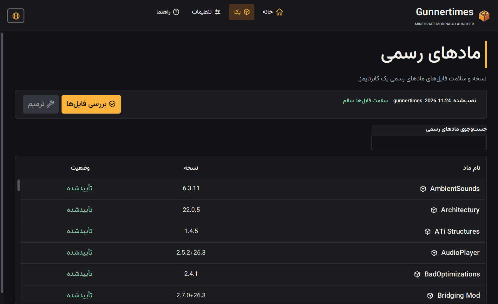

<p align="center"></p>

<h1 align="center">Gunnertimes Launcher</h1>

<p align="center">Install the official Gunnertimes modpack and launch Minecraft from one Windows app.</p>

<p align="center">
  <a href="https://github.com/ParsaUltimate/gunnertimes-releases/releases/latest/download/Gunnertimes-Setup.exe"><strong>Download Windows Setup</strong></a> ·
  <a href="https://github.com/ParsaUltimate/gunnertimes-releases/releases/latest/download/Gunnertimes-Portable.jar"><strong>Download Portable JAR</strong></a> ·
  <a href="https://github.com/ParsaUltimate/gunnertimes-releases/releases/latest">Release notes</a>
</p>

<p align="center"><strong>Windows x64</strong> · Minecraft 26.3 · Fabric Loader 0.20.1 · English / فارسی</p>

<p align="center"><a href="#quick-start">Quick start</a> · <a href="#where-files-are-stored">File locations</a> · <a href="#launcher-tour">Launcher tour</a> · <a href="#troubleshooting">Troubleshooting</a></p>


## Quick start

### 1. Choose a download

| Edition | Requirements and setup |
| --- | --- |
| **Windows Setup** | Includes Java 25 and installs for the current Windows user. A fresh install defaults to `%LOCALAPPDATA%\Gunnertimes Launcher`. Use **Browse** to choose another new or empty folder on a local drive. Setup opens the launcher after installation. Upgrade installs reuse the registered location. |
| **Portable JAR** | Requires Java 25 x64. Put the JAR in a writable folder, open a terminal there, and run the command below. Paths can include spaces and Persian characters. |

```powershell
java -jar Gunnertimes-Portable.jar
```

### 2. Set up your player profile

1. In **Settings → Player and profile**, enter an offline username with 3–16 characters using English letters, digits or underscores.
2. Keep the default profile for a fresh install. To reuse a profile, select the folder that contains its `mods`, `config` and `saves`. Select **Save settings**.
3. On **Home**, choose **Install** to download the official pack. Select **Play** when installation finishes. Stay online for the first setup and whenever required files need downloading.

Use the globe in the top navigation to switch between English and فارسی. The launcher remembers your choice.

<details>
<summary>راهنمای شروع به فارسی</summary>

<div dir="rtl">

۱. برای نصب عادی، <code>Windows Setup</code> را اجرا کن. جاوا همراه نصاب است و می‌توانی با <code>Browse</code> پوشهٔ نصب را انتخاب کنی. نسخهٔ <code>Portable JAR</code> به جاوای ۲۵ نسخهٔ ۶۴ بیتی نیاز دارد.

۲. از نشان کرهٔ زمین، فارسی را انتخاب کن. در تنظیمات، بخش بازیکن و پروفایل را باز کن. نام کاربری آفلاین باید ۳ تا ۱۶ نویسه و شامل حروف انگلیسی، عدد یا زیرخط باشد. مسیر پیش‌فرض را بپذیر یا پوشهٔ پروفایل خودت را انتخاب کن و تنظیمات را ذخیره کن.

۳. در صفحهٔ اصلی، بستهٔ رسمی را نصب کن و پس از پایان نصب، «بازی» را بزن. برای نصب اول و دریافت فایل‌های موردنیاز، اینترنت لازم است.

</div>

</details>

## Where files are stored

| Location | Purpose |
| --- | --- |
| `%APPDATA%\.minecraft` | **Default shared Minecraft folder.** The launcher reads healthy `assets`, `libraries` and `versions` directly here, including files you already have. It checks missing or damaged files against official Minecraft and Fabric metadata, reuses verified files from the older launcher cache when available, and downloads what it still needs. |
| `%LOCALAPPDATA%\Gunnertimes\profiles\Gunnertimes` | **Default Gunnertimes profile.** Your `mods`, `config`, `saves` and game logs go in the selected profile. You can choose another writable folder. If you select an existing `mods` directory, the launcher uses its parent as the profile. |
| `%LOCALAPPDATA%\Gunnertimes Launcher` | **Default location for the installed application.** Choosing another location in Setup moves the application files for that installation. Profiles and preferences keep their own locations. |

See the resolved Minecraft folder in **Settings → Downloads & updates**. Open the active profile and log folders from Settings or Help.

## Launcher tour

| Page | What you can do |
| --- | --- |
| **Home** | **Play** starts Minecraft. **Join Gunnertimes** also attempts to connect to the official server. **Update** previews a newer official pack. Home shows the installed pack version and server status when available. |
| **Pack** | Search official mods and see file health. **Verify files** checks the installed files. **Repair** previews the files to restore, then repairs the installed official release when you confirm. Your unrelated files are preserved. |
| **Settings** | Choose your language, profile, display options, Java and RAM. Use Storage and Diagnostics to find folders, measure disk usage or copy a diagnostic summary. Open **About** for your launcher version, release links and **Check for launcher updates**. |
| **Help** | Find first-launch steps, examples of profile paths you can copy, an explanation of Play and Join, recovery steps, and a shortcut to the active logs folder. |

### Update the launcher or the pack

| What to update | Where to do it |
| --- | --- |
| **The Windows app** | Use **Settings → About → Check for launcher updates**, or accept the offer at startup. **Update and restart** verifies the download, then upgrades your current installation or replaces your portable JAR and reopens the launcher. Use **Later** or **Cancel** to keep using your current build. |
| **The official modpack** | Use **Home → Update** when a newer pack is available. Review the installed and target versions, then select **Continue**. The update applies to the active profile. Use **Pack → Verify files** to check the result. |

See the [Windows update verification report](docs/upgrade-verification.md) for the tested versions, recovery cases and screenshots.

<details>
<summary>See Pack, Help and Settings</summary>

| Pack · فارسی | Help · فارسی |
| --- | --- |
|  |  |

**Settings → About**


</details>

## Troubleshooting

- **Setup failed.** Note the error code and check `%LOCALAPPDATA%\Gunnertimes\setup-logs`.
- **Download failed.** Reconnect and select **Try again**. The launcher reuses files that pass verification.
- **An official mod is damaged.** Close Minecraft and open **Pack → Verify files**. Preview and confirm **Repair**. If the launcher names a conflicting manual mod, back it up and move it outside the profile’s `mods` folder before retrying.
- **Minecraft closed or failed to open.** Select **Open game log** in the progress panel when available. For both launcher and game logs, use **Help → Logs and offline use → Open logs**.
- **Playing offline.** Once the pack and required game files are present, **Play** works offline for single-player. Joining a multiplayer server requires that server to accept offline accounts.

<details>
<summary>For maintainers · build, test and publish</summary>

## Build and test

Use Windows x64 and PowerShell 7. The build downloads and checksums pinned OpenJDK, Gson and WiX archives into the ignored `launcher/build/toolchain` directory. The native update helper uses the .NET Framework 4 compiler included with supported Windows. From a fresh checkout:

```powershell
./launcher/build.ps1
./launcher/test.ps1 -ApplicationImage '<path-to-built-Gunnertimes-directory>' -Ui
```

The build prints the paths to the installer and portable JAR. Use `-JarOnly` for the JAR, `-JdkHome` for a local JDK 25 x64, or `-Channel` for an isolated test pack channel. Run `-Ui` on an interactive Windows desktop. Both player builds use `launcher/resources/launcher-version.txt`.

## Automated launcher releases

GitHub Actions builds and tests a version on Windows when its `launcher-vX.Y.Z` tag is pushed. Update `launcher/resources/launcher-version.txt` on `main` before tagging. A manual run on `main` builds and tests when the release tag field is empty. Supply an existing tag there to retry a tagged release.

Configure these Actions secrets in the source repository once:

- `LAUNCHER_SIGNING_KEY` is the Base64-encoded current Ed25519 PKCS#8 private key. The signing tool checks it against the public key bundled in the launcher.
- `LAUNCHER_RELEASE_TOKEN` is a fine-grained GitHub token with Contents read/write for `ParsaUltimate/gunnertimes-releases` only. Enter it directly in the repository’s Actions secrets.

After both release files are public and their SHA-512 hashes match the build, the workflow advances the signed stable channel. If publishing succeeded but the public verification or channel write failed, verify both published files against the signed manifest in the release notes and recover the channel using the same signed body.

## Manual release recovery and diagnostics

1. Increment `launcher/resources/launcher-version.txt` and commit the source. Build both artifacts from that commit with the default toolchain. Preserve the installer upgrade UUID and signed update public key.
2. With Java 25 on the publishing workstation, compile the signing utility with `javac -encoding UTF-8 -cp "$jar" -d "$signingClasses" launcher/packaging/SignLauncherRelease.java`, where `$jar` is the new portable JAR and `$signingClasses` is an existing working directory. Write plain-text release notes to `$notes`, with the portable Java 25 x64 prerequisite.
3. Generate the signed body with `java -cp "$jar;$signingClasses" SignLauncherRelease sign "$artifactDir" "$privateKey" "$notes" "$signedBody"`. The private key is a PKCS#8 Ed25519 file stored outside the repository. The signer verifies it against the bundled public key. Preserve the signing key for future updates and keep a secured backup. A new, independent channel can bootstrap a key pair with `SignLauncherRelease generate-key PRIVATE_FILE PUBLIC_FILE` before its first build.
4. Create a draft in `ParsaUltimate/gunnertimes-releases` with tag `launcher-vX.Y.Z` using `gh release create`, `--notes-file "$signedBody"` and the two player assets. Check file sizes and names, then publish with `gh release edit launcher-vX.Y.Z --draft=false --latest=false`. Link the source revision and [matching OpenJDK source](https://github.com/microsoft/openjdk-jdk25u/tree/release/jdk-25.0.2_10) in the notes.
5. Confirm the GitHub release is neither a draft nor a prerelease, and both asset URLs work without authentication. In the public releases repository, commit the same signed body as `launcher-stable.md` on `main`. The client reads that signed file anonymously, then downloads the matching artifact from GitHub Releases. Leave this file untouched for prereleases. Mark the verified stable release as latest after updating the channel. Only the publisher needs GitHub credentials.

Installed release state is pinned by `.gunnertimes/signed-release.json`. Updates commit it in the same transaction as payloads and ownership. Repair replaces damaged owned files only after confirmation and retains their originals in the transaction backup. Treat versions as immutable and increment the version for each pack change.

Home reads release notes from a published release tag matching the signed pack version in the official release repository. An optional signed manifest property `serverCompatibility` can contain the official `address`, an ISO 8601 `expires` timestamp and a non-empty `allowedPackVersions` array. Only a fresh, valid signed declaration for the configured server can block a Join. Ordinary server status responses supply online status and an optional player count.

Launcher and Minecraft logs are in the selected profile's `logs` folder. The Settings diagnostic clipboard summary omits the username, paths and raw logs. The storage page measures categories without deleting player files or offline cache data.

## Design references

[Gunnertimes pack releases](https://github.com/ParsaUltimate/gunnertimes-releases) · [Lunar launcher](https://www.lunarclient.com/news/the-new-launcher-is-here) · [Lunar settings](https://www.lunarclient.com/news/lunar-client-monthly-recap-14-may-2025) · [XMCL launch implementation](https://github.com/Voxelum/minecraft-launcher-core-node/blob/master/packages/core/launch.ts)

Persian UI typography uses the official Dastkhat Main static Regular, Medium and SemiBold files. The TTFs load directly from the application JAR. The package includes the OFL notice and pinned source in `licenses/Dastkhat`. [Dastkhat v1.220 source](https://github.com/dastyar-io/dastkhat-font/tree/19f4a12b56a89567b07e02500f0e4aed670e3644)

</details>
