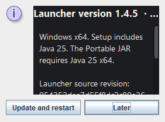
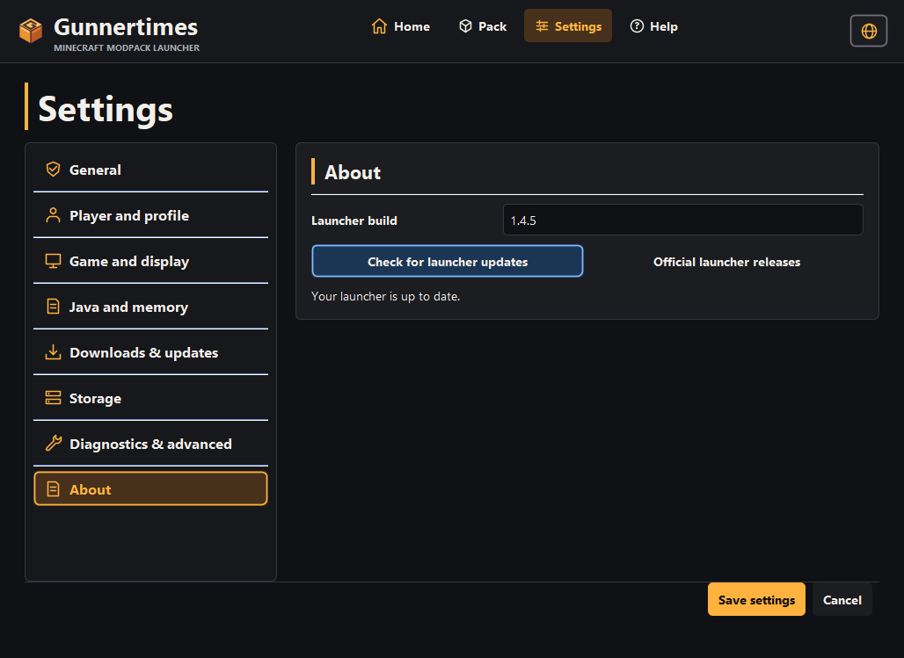
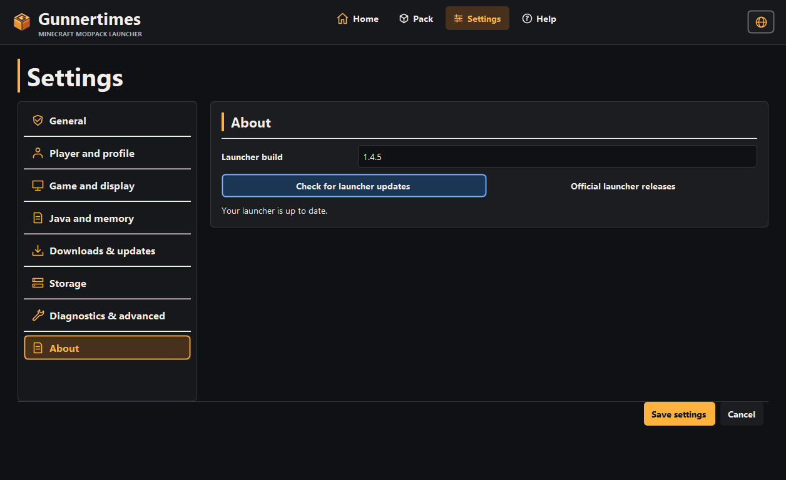
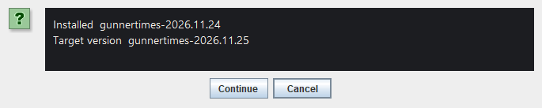
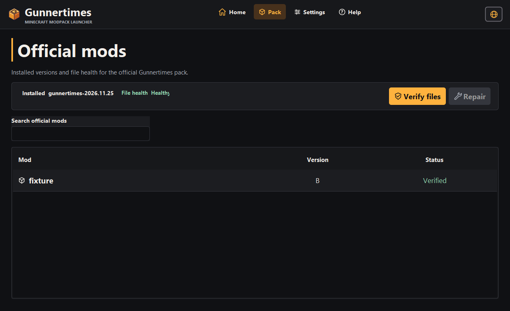

# Windows update verification

Tests target [launcher 1.4.5](https://github.com/ParsaUltimate/gunnertimes-releases/releases/tag/launcher-v1.4.5) and keep player data in disposable profiles.

| Scenario | Result |
| --- | --- |
| Public portable JAR 1.4.1 → 1.4.5 | **Passed.** Startup and manual checks offered the public update. Later and Cancel preserved 1.4.1. Retry replaced the JAR in a folder containing spaces and Persian characters, reopened it as 1.4.5 and matched the public SHA-512. Preference, world, config and manual mod hashes stayed the same. |
| Public Windows per-user installation 1.4.1 → 1.4.5 | **Passed.** The installed launcher offered the public update at startup and from Settings. Later and Cancel kept 1.4.1. Retry downloaded Setup, closed the old process, upgraded in place and reopened at 1.4.5. The Windows Installer location, preferences and profile file hashes stayed the same. The existing shortcut opened 1.4.5 again. [GitHub Actions run](https://github.com/ParsaUltimate/gunnertimes-launcher/actions/runs/46050018713). |
| Manual check in About | **Passed.** An archived 1.4.4 portable build checked the real stable channel from **Settings → About** and updated to 1.4.5. The older 1.4.1 build uses **Downloads & updates** for its manual check. |
| Locked installation file with the published 1.4.1 helper | **Automatic recovery unverified on the hosted runner.** The helper detected the exclusive lock and stopped before Setup. The runner could not complete the old helper's modal-error flow, which waits for the message to close before reopening the previous build. [Failure evidence](https://github.com/ParsaUltimate/gunnertimes-launcher/actions/runs/46050011730). |
| Locked installation file with the corrected helper | **Passed.** A 1.4.4 QA baseline built from current source rejected the locked file and reopened the same build before the error dialog was dismissed. Its JAR hash stayed the same. After the lock was removed, retry upgraded it to the published 1.4.5 in place and the shortcut reopened it. [GitHub Actions run](https://github.com/ParsaUltimate/gunnertimes-launcher/actions/runs/46050426349). |
| Signed QA pack A → B | **Passed.** Home installed A, displayed B and required confirmation before applying it. A truncated B payload failed and left A healthy. Retrying with the complete payload installed B. Pack showed B as verified. Player files and the launcher JAR matched their original hashes. |

The portable test cancelled an in-progress transfer from the actual launcher dialog. The pack test used a local signed channel serving a truncated payload. Both exercises leave the public pack channel untouched.

The recovery change is in source commit [`7e5c6d8`](https://github.com/ParsaUltimate/gunnertimes-launcher/commit/7e5c6d8). The public 1.4.5 assets are the original release builds. The recovery test used the corrected helper in its starting launcher.

## Screenshots

### Installed launcher

| Update offered at startup | About after restarting |
| --- | --- |
|  |  |

### Portable launcher

| Cancelling a download | About after restart |
| --- | --- |
|  |  |

### Signed test pack

| Update preview | Pack after Verify files |
| --- | --- |
|  |  |

## Repeat the checks

On an interactive Windows desktop, run the usual `launcher/test.ps1 -Ui` suite against an application image. The suite prints the path to its signed pack UI screenshots. The public launcher check is separate.

```powershell
./launcher/test-public-upgrade.ps1 -Jdk '<Java 25 JDK>' -Evidence '<new test folder>'
```

Add `-Installed -SkipLockProbe` only in a disposable Windows account without Gunnertimes installed. For the hosted Windows test, run **Test public launcher upgrade** under Actions. Select the public baseline and expected stable versions. Enable `test_lock` to build the baseline from the current checkout and exercise the recovery code before installing the public update. The artifact contains screenshots and the result.
